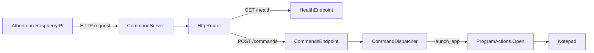

# Athena Desktop

Athena Desktop is the Windows desktop client for Athena, written in C#.

On `codex/agent-mcp-rebuild`, the default role is **Windows-MCP supervisor**.
Athena's agent and voice pipeline stay on the Raspberry Pi; the Pi connects
directly to Windows-MCP's Streamable HTTP endpoint. This tray application starts
and stops the preinstalled upstream process in your Windows user session.

Start with [Windows-MCP setup](docs/WINDOWS_MCP.md) and the shared
[architecture plan](docs/ARCHITECTURE.md). Copy the example configuration, provision
the pinned upstream runtime, and run `--check-config` before starting it.

```text
Athena agent on Pi -> MCP over HTTP -> Windows-MCP -> Windows controls
                                          ^
                               Athena Desktop owns process
```

The sections below document the retained **legacy HTTP mode**. Select it
explicitly using `ATHENA_DESKTOP_MODE=legacy`. Existing pending background/startup
work is preserved; its installer now accepts `-Mode mcp` or `-Mode legacy`.

## Architecture

Athena runs on the Raspberry Pi and handles voice transcription and command routing. The desktop client receives structured commands from Athena and executes supported Windows actions.

- **Athena:** Decides what action to perform and which backend should handle it.
- **Athena Desktop:** Executes supported PC actions and returns their results.
- **Home Assistant:** Handles smart-home actions separately from the desktop client.

The initial focus is deterministic commands. LLM fallback is a later Athena feature and is not required for desktop control.

The HTTP implementation separates listener lifecycle, routing, and endpoint behavior:

- `src/server/CommandServer.cs` accepts HTTP requests, delegates to the router, and closes responses.
- `src/server/HttpRouter.cs` matches URL paths and returns 404 for unknown routes.
- `src/server/endpoints/` contains endpoint classes that define their paths, validate methods, and handle requests.
- `src/dispatch/CommandDispatcher.cs` maps command names to action handlers and returns command results.
- `src/actions/ProgramActions.cs` resolves supported application names and starts their executables.
- `src/actions/PowerActions.cs` requests Windows shutdown, restart, or sleep after the command response is sent.
- `src/Program.cs` registers endpoints with the router, connects the dispatcher, and configures the server.
- `src/hosting/` manages the notification area icon, session lifecycle, and file logging.
- `scripts/desktop.ps1` publishes the client, installs its login shortcut, and manages the installed process.

To add an endpoint, implement `IHttpEndpoint` in the endpoints directory and register it in `Program.cs`.

## Current Progress

The desktop supports HTTP health checks, application launching, shutdown, restart, and sleep through `POST /commands`. The first supported application is Notepad. The complete Pi-to-desktop application launch flow has been tested: an HTTP command reaches the dispatcher, launches Notepad, and returns a result.

Closing, minimizing, focusing, and arranging application windows are future actions and are not implemented yet.



## Background operation

Athena Desktop runs in the signed-in user's session with a notification area icon and no terminal window. This lets commands launch applications on that user's desktop. Right-click the icon to open the log file or exit. Each user session runs one instance; starting it again leaves the existing listener running.

Install from a regular PowerShell terminal in this repository. The installer needs the .NET 10 SDK and the [.NET 10 Windows Desktop Runtime](https://dotnet.microsoft.com/en-us/download/dotnet/10.0) for your Windows architecture. Set the bind address to the desktop's actual LAN IP so the Pi can reach it:

```powershell
powershell -NoProfile -ExecutionPolicy Bypass -File .\scripts\desktop.ps1 -Action Install -Mode legacy -BindHost 192.168.68.138
```

The installer publishes a Release build to `%LOCALAPPDATA%\AthenaDesktop\app`, creates `Athena Desktop.lnk` in your Startup folder, and starts the client. It starts again when you sign in; signing out ends that session. Installation does not need administrator rights. HTTP URL reservations and firewall access for the chosen address and port must already be configured separately.

`-BindHost` saves `ATHENA_BIND_HOST` for your user and clears an existing `ATHENA_HTTP_PREFIX` override. For a complete URL instead, use `-HttpPrefix http://192.168.68.138:5001/`. Omitting both options preserves the current settings. Re-run `Install` to update the app: publishing completes before the running instance is stopped.

Manage the installed client with:

```powershell
powershell -NoProfile -ExecutionPolicy Bypass -File .\scripts\desktop.ps1 -Action Status
powershell -NoProfile -ExecutionPolicy Bypass -File .\scripts\desktop.ps1 -Action Stop
powershell -NoProfile -ExecutionPolicy Bypass -File .\scripts\desktop.ps1 -Action Start
powershell -NoProfile -ExecutionPolicy Bypass -File .\scripts\desktop.ps1 -Action Uninstall
```

`Status` checks the running instance in your Windows session; use `GET /health` below to check the HTTP listener. `Stop` also cancels a pending power action during its delay. `Uninstall` removes the login shortcut and files recorded by the installer, while preserving logs and user environment settings. An optional `-InstallDirectory` selects a dedicated installation folder; provide the same path to later management commands.

Logs are written to `%LOCALAPPDATA%\AthenaDesktop\logs\athena.log`, with three archived files and rotation at 5 MB. For live terminal output, run the executable with `--console`; Ctrl-C stops that instance. The executable also supports `--stop`, `--status` (exit code 0 when running, 1 when stopped), and `--help`.

## Development

The client targets .NET 10 for Windows. Build and run with terminal output:

```powershell
dotnet build src/Athena.Desktop.csproj
dotnet run --project src/Athena.Desktop.csproj -- --console
```

Run the regression checks with `dotnet run --project tests/Athena.Desktop.RegressionTests.csproj`. They use fake power actions and temporary localhost ports to check response ordering, cancellation, and deferred failure handling without changing the computer's power state.

The server listens on `http://localhost:5000/` by default and accepts `POST /commands`:

```json
{
  "requestId": "example-1",
  "command": "launch_app",
  "parameters": { "name": "notepad" }
}
```

When the launch succeeds, the server returns HTTP 200:

```json
{
  "requestId": "example-1",
  "success": true,
  "message": "Launch requested for 'notepad'."
}
```

Malformed JSON or a missing command returns HTTP 400. Dispatched commands return HTTP 200 with a `success` flag: unsupported commands, unknown applications, invalid application parameters, and launch failures return `success: false` with an explanatory message. Responses preserve the request ID. Unknown routes return HTTP 404; unsupported methods return HTTP 405 with an `Allow` header. Requests are processed sequentially.

Power commands use the same request format, for example `{"requestId":"example-2","command":"restart"}`. The server returns HTTP 200 with `{"requestId":"example-2","success":true,"message":"Restart accepted."}` and closes the response before executing the action. Each action waits two seconds in the application:

| Command | Acknowledgement | Windows action |
| --- | --- | --- |
| `shutdown` | `Shutdown accepted.` | `shutdown.exe /s /t 0` |
| `restart` | `Restart accepted.` | `shutdown.exe /r /t 0` |
| `sleep` | `Sleep accepted.` | `SetSuspendState` requesting sleep with wake events enabled |

Shutdown and restart leave applications free to block the request if they have unsaved work. Sleep uses the [Windows power API](https://learn.microsoft.com/en-us/windows/win32/api/powrprof/nf-powrprof-setsuspendstate) and temporarily enables the process's existing shutdown privilege. Windows must support sleep and the client account must have the required power-management permission; unsupported or denied requests are logged as failures.

The acknowledgement means the desktop accepted the command; it does not confirm that Windows performed the action. Any later failure is recorded in the log file and, in console mode, standard error. Stopping the server during the delay cancels the pending action. Completing the HTTP response does not prove the Pi received it.

The dispatcher is connected through the `CommandsEndpoint` constructor in `Program.cs`. An endpoint constructed without a handler still returns HTTP 501 for valid commands. Add application mappings in `ProgramActions` and register new action handlers in `CommandDispatcher`.

Use `GET /health` to check that the HTTP server is responding:

```powershell
Invoke-RestMethod http://localhost:5000/health
```

It returns HTTP 200 with `{"status":"ok"}` without executing a command. Other methods return HTTP 405. To test from the Pi, run `curl http://192.168.68.138:5000/health`, replacing the address with your desktop's configured LAN IP.

For Pi access, set `ATHENA_BIND_HOST` to your desktop's LAN IP before starting the process:

```powershell
$env:ATHENA_BIND_HOST = "192.168.68.138"
dotnet run --project src/Athena.Desktop.csproj -- --console
```

This listens on `http://192.168.68.138:5000/`. The client reads process environment settings first, then saved user settings. If `ATHENA_BIND_HOST` is unset or blank in both, the host defaults to `localhost`. The installer can persist the IP for login startup with `-BindHost`.

`ATHENA_HTTP_PREFIX` remains available for a complete URL override, including a custom port, such as `http://192.168.68.138:5001/`. A nonblank `ATHENA_HTTP_PREFIX` takes precedence over `ATHENA_BIND_HOST` and must include a trailing slash.

Windows may require an HTTP URL reservation and an inbound firewall rule for that address and port. The scaffold has no authentication; use it only on a trusted development network. Exit from the notification area icon, use `--stop`, or press Ctrl-C in console mode to stop the listener.

## Related Repository

- [Athena](https://github.com/b-stha/athena): Raspberry Pi assistant and command router.
